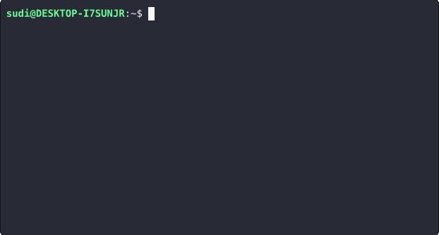

# Podlet

**Deploy a GitHub repo to your own server with one command.**

Podlet is a self-hosted deploy platform. Connect a repository, pick a server, and Podlet builds it, runs it in Docker and gives it a public HTTPS URL. There is no Dockerfile to write and no ports to open.

<p align="center">
  
</p>

## Why Podlet

- **Your hardware.** Run apps on a VPS, a Raspberry Pi or a home server instead of paying per-app platform fees.
- **No config.** Apps are built with [Railpack](https://railpack.com) on BuildKit, so Podlet detects the language and builds it.
- **No open ports.** Each server connects out through a Cloudflare Tunnel, so it works behind NAT or a firewall.
- **Live feedback.** `podlet deploy` streams each build step to your terminal over SSE.

## How it works

```
 podlet CLI ──▶ Podlet API ◀── agent (on your server)
                   │               │  claims jobs, runs them
              Postgres             ▼
                          Railpack/BuildKit ─▶ Docker ─▶ Cloudflare Tunnel ─▶ https://app.podlet.dev
```

1. The **CLI** talks to the **API**, which queues a job for the chosen server.
2. The **agent** on that server polls for jobs, then clones, builds and starts the app as a Docker container.
3. The agent creates a DNS record and tunnel route for the app, then removes the previous deploy.

## Getting started

**1. Install the CLI**

```bash
curl -fsSL https://get.podlet.dev/cli/install.sh | bash
```

**2. Log in and connect GitHub**

```bash
podlet auth login
podlet repos connect
```

**3. Add a server**

```bash
podlet servers add
```

This prints a one-time registration token that expires in 10 minutes. On the server, install the agent and paste the token when prompted:

```bash
curl -fsSL https://get.podlet.dev/agent/install.sh | sudo bash
```

**4. Deploy**

```bash
podlet deploy
```

Add `-d` to queue the deploy and exit without watching it.

## Commands (as of now)

| Command | What it does |
| --- | --- |
| `podlet deploy [-d]` | Pick a repo and a server, then deploy. `-d` detaches. |
| `podlet auth login` | Log in with GitHub. |
| `podlet auth me` | Show the current user. |
| `podlet auth logout` | Log out of this machine. |
| `podlet auth revokeall` | Revoke every active session. |
| `podlet repos connect` | Choose which GitHub repositories Podlet can read. |
| `podlet repos get` | List the repositories Podlet can read. |
| `podlet servers add` | Create a registration token for a new server. |
| `podlet servers get [id] [-p]` | List servers or show one. `-p` shows pending servers. |
| `podlet servers update` | Rename a server (interactive). |
| `podlet servers delete` | Delete a registered or pending server (interactive). |
| `podlet jobs get [id]` | List jobs or show one. Filter with `--server` and `--status`. |
| `podlet health` | Check that the API is reachable. |
| `podlet uninstall` | Remove the CLI. |

## Tech stack

- **Go** for the API, CLI and server agent, in one module
- **chi**, **uber/fx**, **Postgres** with **pgx** and **sqlc**, and **goose** migrations
- **cobra** and **pterm** for the CLI
- **Docker**, **Railpack/BuildKit** and **Cloudflare Tunnel** for builds and routing
- **Next.js** for the landing page

## Project layout

```
cmd/                 api, cli and agent entrypoints
internal/api/        handler → service → repository → sqlc
internal/agent/      job executors and chains that run on the server
internal/cli/        cobra commands
internal/contract/   request and response types shared by all three
frontend/            landing page
```

## Current limitations

- The agent runs one job at a time.
- Linux (amd64) servers only.
- GitHub repositories only, and one app per repository (no monorepos yet).
- No environment variables, so apps that need secrets or config can't be deployed yet.
- No log viewing, and no commands to redeploy or delete a deployment.

## Coming soon

- Monorepo support
- Hosted Postgres databases
- Environment variables
- Logs and metrics
- Redeploy and delete-deployment commands

## Feedback

Podlet is early, and I'm deciding what to build next from what people ask for. Open an [issue](https://github.com/SudiMango/podlet/issues) to report a bug, request a feature, or tell me what you'd want to deploy. Upvote existing issues with a 👍 so I can see what matters most.
